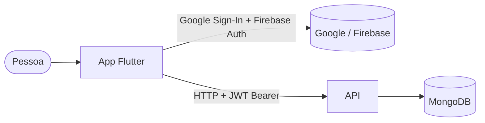

# Documentação técnica do app

App Flutter (Android) para controlar ganhos e gastos mês a mês. A pessoa entra com a conta Google, lança valores à vista ou parcelados (até 30x) e vê, em cada mês, o resumo de ganhos, gastos e balanço. Os dados ficam na [API](https://github.com/Janilso/planejamento_financeiro_api), que tem o contrato das rotas no Swagger (`/docs`) e a própria documentação técnica.

- **Como rodar:** [README do projeto](../README.md).

## Índice

| Documento | Assunto |
|---|---|
| [Arquitetura](arquitetura.md) | Camadas, pastas, injeção de dependência e inicialização |
| [Autenticação e sessão](autenticacao-e-sessao.md) | Login, tokens, renovação automática, sessão expirada e Sair |
| [Home e lançamentos](home-e-lancamentos.md) | Meses, abas, lista, formulário, edição e exclusão |
| [Tema e layout](tema-e-layout.md) | Cores, texto, espaçamento, exceção de contraste e componentes do tema |
| [Dados e API](dados-e-api.md) | Models, repositório, cliente HTTP e tratamento de erros |
| [Testes](testes.md) | Dublês, padrões dos testes de widget e CI |
| [Ambiente](ambiente.md) | Flutter, Firebase, API local, celular por ADB e release |
| [Contribuindo](contribuindo.md) | Roteiro para mudanças e convenções |

## Visão geral

## Limitações conhecidas

- **Valor R$ 0,00 é aceito no formulário.** A API recusa, e a mensagem dela aparece dentro do modal.
- **Deslizar na lista troca Ganhos/Gastos, não o mês.** A troca de mês funciona arrastando sobre o resumo ou tocando nas abas.
- **Contraste das cores da marca:** ganhos (`#44A2A6`) e gastos (`#F7646C`) ficam com 3:1 contra o branco, o que atende o WCAG AA só para texto grande. É uma escolha de identidade (veja [Tema e layout](tema-e-layout.md)); rótulos, abas e valores da lista ficam abaixo de 4,5:1.
- **Fonte do sistema acima de 130%** não tem suporte: o cabeçalho não rola junto com a lista.
- Só Android; a assinatura de release ainda usa a chave de debug.

## Ideias de evolução

- **Produto:** gráficos do mês (`fl_chart`), lembretes de contas (`flutter_local_notifications`), biometria para abrir (`local_auth`), cache offline do último mês, exportar o mês em CSV e erros em produção com Crashlytics.
- **IA (opcional):** categorização automática, lançamento por texto ("gastei 45 no mercado ontem, em 3x"), leitura de comprovante e resumo do mês. Sempre com confirmação da pessoa antes de gravar e mandando ao modelo só o necessário.
