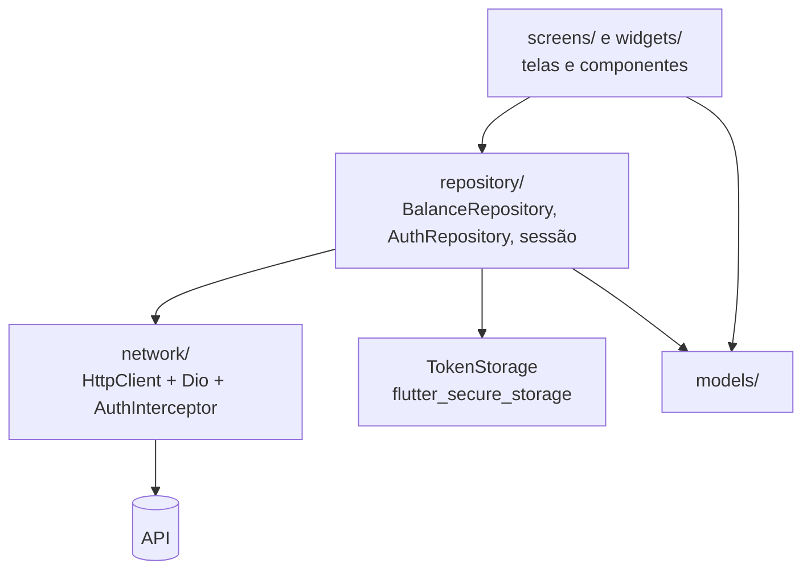

# Arquitetura

## Camadas



| Camada | Pasta | Responsabilidade |
|---|---|---|
| Telas | `lib/screens/` | Splash, login e home: estado da tela e navegação |
| Componentes | `lib/widgets/` | Abas de meses, lista, resumo, formulário, campos, botão e carregamento |
| Repositórios | `lib/repository/` | Falam com a API e com o armazenamento; convertem erros em `ApiException` |
| Rede | `lib/network/` | URL da API, cliente HTTP sobre o Dio, interceptor de autenticação |
| Modelos | `lib/models/` | `BalanceModel`, `GroupBalanceModel`, `MonthBalanceModel` |
| Utilitários | `lib/commons/`, `lib/theme/`, `lib/extensions/` | Meses, formatação de R$ e datas, textos, ícones, cores e estilos |

As telas recebem as dependências por parâmetro opcional (`repository`, `clock`, `onLogout`, `signIn`). Em produção, o padrão vem do injetor; nos testes, entram dublês.

## Pastas

```
lib/
├── main.dart              inicialização e MaterialApp
├── firebase_options.dart  gerado pelo FlutterFire
├── screens/               splash.dart, login.dart, home.dart
├── widgets/               balance_tab_view.dart, formBalance/, infiniteTabelView/, …
├── repository/            balance.dart, auth.dart, token_storage.dart, session.dart, injector.dart
├── network/               api_config.dart, http_client.dart, auth_interceptor.dart, session_events.dart
├── models/                balance.dart, group_balance.dart, month_balance.dart
├── commons/               months.dart, formats.dart, icons.dart
├── theme/                 colors.dart, texts_style.dart, theme.dart
└── extensions/            string.dart
tool/celular.sh            instala e opera o app no celular por ADB
```

## Injeção de dependência (`lib/repository/injector.dart`)

O `appInjector` (`auto_injector`) monta tudo uma vez:

- **`TokenStorage`:** `SecureTokenStorage`, sobre o `flutter_secure_storage`.
- **Dois Dio:**
  - um **sem interceptor**, só para o `AuthRepository` (`/auth/login`, `/auth/refresh`, `/auth/logout`): assim o refresh nunca dispara outro refresh;
  - um **com o `AuthInterceptor`**, para as demais rotas.
- **`HttpClient`** e **`BalanceRepository`** como singletons, usando o Dio com interceptor.

## Inicialização (`lib/main.dart`)

1. `initializeDateFormatting('pt_BR')` e `Intl.defaultLocale = 'pt_BR'`.
2. `Firebase.initializeApp` e `GoogleSignIn.instance.initialize()`.
3. Registra o `onSessionExpiredHandler`: volta ao login e mostra "Sua sessão expirou. Entre de novo.".
4. `MaterialApp` com `navigatorKey` e `scaffoldMessengerKey` globais (o handler acima navega e mostra a SnackBar sem `BuildContext`), tema, localizações (Material e `form_builder_validators`) e a `SplashScreen` como tela inicial.
