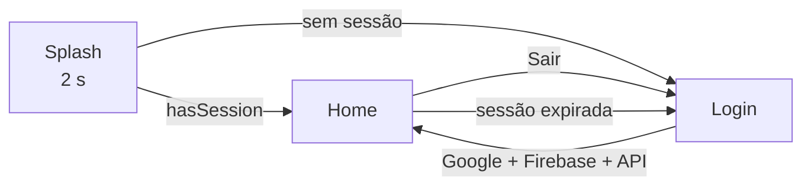
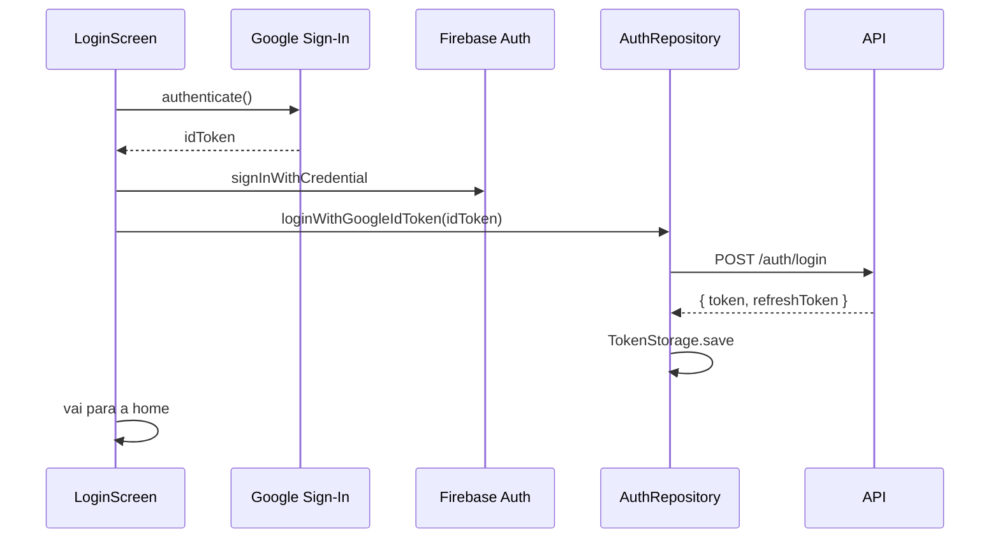

# Autenticação e sessão

## Telas

A splash espera 2 segundos e chama `hasSession` (`lib/repository/session.dart`): há sessão quando o Firebase está logado **e** os tokens da API existem no armazenamento. Com sessão, a splash busca os lançamentos nesses 2 s e a home abre já com eles, sem loader; se a busca falhar, a home faz a própria. Detalhes da animação em `tema-e-layout.md`.

## Login (`lib/screens/login.dart`)

- **Cancelar o seletor de conta** não mostra erro.
- **Qualquer outra falha** mostra "Não foi possível entrar. Tente de novo.".
- **Se a API recusar,** o app sai do Firebase e do Google, para não ficar meio logado.
- O `signIn` é injetável, para os testes simularem sucesso, erro e cancelamento.

## Tokens (`lib/repository/token_storage.dart` e `auth.dart`)

- `TokenStorage` é uma interface com `read`, `save` e `clear`. Em produção, `SecureTokenStorage` grava no armazenamento seguro do Android; nos testes, `InMemoryTokenStorage`.
- `AuthRepository`:
  - `loginWithGoogleIdToken` grava os tokens;
  - `refresh()` devolve `true` se renovou e `false` se a sessão não pode mais ser renovada;
  - `logout()` tenta revogar na API, mas **sempre** apaga os tokens locais, mesmo sem rede.

## Renovação automática (`lib/network/auth_interceptor.dart`)

O `AuthInterceptor` é um `QueuedInterceptor` no Dio da API:

1. **Toda requisição** recebe `Authorization: Bearer <token>`, quando há token salvo.
2. **Num 401 ou 403**, chama `refresh()` e repete a requisição uma vez (marcada com `auth_retried`, para não entrar em laço).
3. **Vários 401 ao mesmo tempo** geram **um refresh só**: como os erros são tratados em fila, os seguintes percebem que o token salvo já é outro e só repetem a requisição.
4. **Se o refresh falhar**, apaga os tokens e chama `onSessionExpired`. No app, isso volta ao login com "Sua sessão expirou. Entre de novo." (`lib/network/session_events.dart` e `lib/main.dart`).

## Sair

O menu ⋮ ("Mais opções") no topo da home tem o item "Sair", que pede confirmação ("Sair da conta?"). Confirmando, `_logout` faz `AuthRepository.logout()`, `FirebaseAuth.signOut()` e `GoogleSignIn.signOut()` e volta ao login, limpando a pilha de telas. Nos testes, o `onLogout` é injetado.
