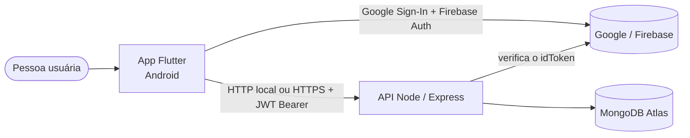
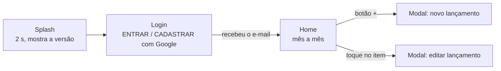
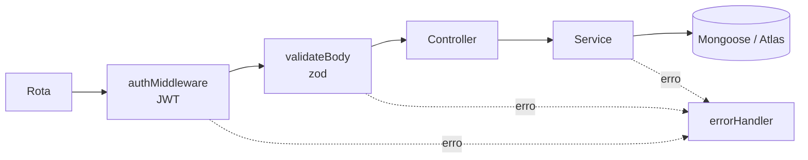
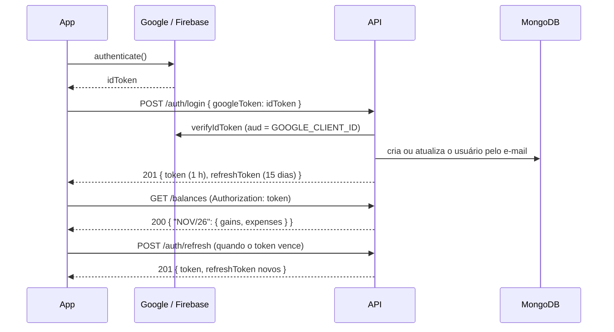

# Planejamento Financeiro: como o app e a API funcionam

> Estado em 26/11/2026. A análise original (25/11) partiu do app na `main` (`b1f07d6`) e da API na `main` (PR #2). Desde então, o plano `docs/superpowers/plans/2026-11-25-correcoes-e-pendencias.md` corrigiu e integrou os dois. O trabalho está nas branches abaixo, **ainda sem PR aberto**:
>
> - app: `fix/app-correcoes` → `feat/app-integracao` → `chore/app-qualidade` (empilhadas);
> - API: `fix/api-correcoes` (tasks A1 a A5). As tasks A6 a A13 ainda não foram feitas.
>
> As seções marcadas com **Atualizado** descrevem o estado dessas branches.

O Planejamento Financeiro é um app pessoal e simples para controlar ganhos e gastos mês a mês. Este documento explica:

- como funcionam hoje o app Flutter e a API Node;
- o que falta para ligar um ao outro;
- quais plugins e agentes ajudam no produto e no desenvolvimento.

## Sumário

1. [Visão geral](#1-visão-geral)
2. [O app (Flutter)](#2-o-app-flutter)
3. [A API (Node)](#3-a-api-node)
4. [Como os dois se conectam](#4-como-os-dois-se-conectam)
5. [Plugins e agentes](#5-plugins-e-agentes)
6. [Próximos passos sugeridos](#6-próximos-passos-sugeridos)

## 1. Visão geral



| Parte | Situação em 25/11 | **Atualizado** (26/11, nas branches) |
|---|---|---|
| Login com Google no app | Funciona (Google Sign-In + Firebase Auth) | Também entra na API, guarda os tokens e mantém a sessão; tem botão Sair |
| Tela mês a mês | Funciona, mas com dados fixos no código | Lê os lançamentos da API |
| Criar e editar lançamento no app | O envio vai para o jsonplaceholder e nada é salvo | Salva na API; editar um parcelado muda o lançamento inteiro |
| Excluir lançamento | Não existe no app nem na API | Arrastar para excluir: só a parcela ou todas |
| API | Login, refresh, criar e listar, com 33 testes | Também logout, editar e excluir, com 63 testes |
| App conectado à API | Ainda não | Sim, testado no celular contra a API local |

## 2. O app (Flutter)

### 2.1 Tecnologias

- Flutter 3.50.1 e Dart 3.14. Por enquanto só Android (`br.com.janilso.planejamentofinanceiro`).
- Firebase (projeto `planejamento-financeiro-e0a27`) para o login.
- Pacotes principais:
  - `google_sign_in` 7 e `firebase_auth` 7: login com Google;
  - `dio` 5 e `auto_injector`: chamadas HTTP e injeção de dependência;
  - `flutter_form_builder`, `form_builder_validators` e `currency_text_input_formatter`: formulário e máscara de R$;
  - `intl`: datas e moeda em pt-BR;
  - `package_info_plus`: versão na splash.

### 2.2 Organização do código

```
lib/
├── main.dart          inicializa pt-BR, Firebase e Google Sign-In e abre a splash
├── screens/           splash, login e home
├── models/            BalanceModel (lançamento), GroupBalanceModel (ganhos e gastos de um mês)
│                      e MonthBalanceModel (mapa "NOV/26" → mês)
├── repository/        BalanceRepository e o injetor de dependências
├── network/           DioFactory (URL base e timeouts) e HttpClient
├── widgets/           abas de meses, lista, resumo, formulário, campos e animação de carregamento
├── theme/, commons/   cores, textos, ícones, imagens e formatação (data e R$)
└── extensions/        capitalize()
```

### 2.3 Fluxo das telas



No login, o `GoogleSignIn.instance.authenticate()` devolve o `idToken`. Com ele, o app entra no Firebase Auth (`signInWithCredential`) e, se houver e-mail, abre a home. Cancelar o login não faz nada. Os outros erros só aparecem no console.

**Atualizado:**
- depois do Firebase, o app chama `POST /auth/login` com o `idToken` e guarda os tokens no armazenamento seguro;
- erros de login aparecem como "Não foi possível entrar. Tente de novo.";
- a splash vai direto para a home quando há sessão no Firebase **e** tokens da API;
- o botão Sair, no topo da home, pede confirmação, revoga o refresh na API e limpa a sessão do Firebase, a do Google e os tokens.

### 2.4 A home: o mês a mês

```
┌────────────────────────────────────┐
│       GANHOS - Novembro 2026       │  barra do topo (a cor muda entre ganhos e gastos)
│  OUT/26   NOV/26   DEZ/26   JAN/27 │  abas de meses, infinitas
│  GANHOS R$ 1.900   GASTOS R$ 1.800 │
│          BALANÇO R$ 100            │  resumo do mês
│        GANHOS   |   GASTOS         │  abas por tipo
│  ● Salário - 5/12       R$ 1.500   │  ● = ainda não realizado
│    Venda da bicicleta     R$ 400   │
│                                (+) │  novo lançamento
└────────────────────────────────────┘
```

- **Meses:** a home monta 12 meses para trás, o atual e 12 para frente. As abas são infinitas: a 4 abas de uma das pontas, o app acrescenta mais 12 meses.
- **Resumo:** ganhos, gastos e balanço (ganhos − gastos) do mês. Entram todos os lançamentos, realizados ou não.
- **Listas:** há duas abas, GANHOS e GASTOS. Cada item mostra:
  - o nome, com "parcela/total" quando é parcelado;
  - o valor em R$;
  - um ponto, quando ainda não foi realizado.
- **Cores:** a tela muda de cor com a aba: verde-água (`#65BCBF`) para ganhos e coral (`#F8777D`) para gastos.
- **Formulário (modal):**
  - nome, obrigatório, até 30 caracteres;
  - valor, com máscara de R$;
  - realizado, uma chave liga/desliga;
  - parcelas, de 1 a 30.

  O lançamento recebe a data do mês da aba aberta.

### 2.5 Dados e rede

- O `BalanceRepository` chama `GET`, `POST` e `PUT /posts` no jsonplaceholder, ignora a resposta e devolve sempre o mesmo JSON fixo. Esse JSON só tem o mês `JUL/25`, então só a aba de julho de 2025 mostra lançamentos e os outros meses aparecem zerados.
- O formato desse JSON é o mesmo que a API devolve em `GET /balances`: um mapa `"MMM/YY"` → `{ gains: [...], expenses: [...] }`.
- O `HttpClient` envolve o Dio, com timeout de 20 s. O `get` não repassa `headers` nem `params`, e isso vai fazer diferença quando o app precisar mandar o token.

**Atualizado:** o jsonplaceholder e o JSON fixo saíram. O `BalanceRepository` chama a API (`GET`, `POST`, `PATCH` e `DELETE` em `/balances`) e converte erros em `ApiException`. O 409 vira "Você já tem um lançamento com esse nome.". O `HttpClient` repassa `headers` e `params` e ganhou `patch`. O `AuthInterceptor` (um `QueuedInterceptor`):
- põe o `Authorization: Bearer`;
- num 401 ou 403, renova o token uma vez só, mesmo que várias requisições falhem juntas, e repete as requisições;
- se a renovação falhar, volta ao login com o aviso "Sua sessão expirou. Entre de novo.".

A URL vem de `--dart-define=API_URL` (padrão `http://127.0.0.1:8080`, via `adb reverse`).

### 2.6 Qualidade

- 2 testes de widget, ambos do `AppButton`.
- O `flutter analyze` mostra 6 avisos `avoid_print`.

**Atualizado:** 38 testes (modelos, meses, formatação, cliente HTTP, autenticação, sessão, repositório, login e home), `flutter analyze` sem avisos e todo o código no `dart format`. O CI (`.github/workflows/ci.yml`) roda formato, analyze e testes em cada PR.

### 2.7 Problemas encontrados no app

**Atualizado:** situação de cada item em 26/11:

| Item | Situação |
|---|---|
| 1. Valor ×100 | Corrigido (B1) |
| 2. Meses nos dias 29 a 31 | Corrigido (B2) |
| 3. Busca repetida e mês errado nas abas | Corrigido (B4): uma busca só, e cada aba lê o próprio mês |
| 4. Arrastar não exclui | Corrigido (B12): diálogo com "Só esta parcela", "Todas as parcelas" ou "Excluir". Se a API falhar, o item fica na lista e aparece um aviso |
| 5. Última parcela sem "12/12" | Corrigido (B3) |
| 6. Erros do login | Corrigido (B6) |
| 7. Valor R$ 0,00 aceito | **Em aberto** no app. A API recusa, e o formulário mostra a mensagem dela |
| 8. Toques repetidos em Salvar | Corrigido (B5): o botão fica em carregando e não responde até a resposta |
| 9. Nada acontece depois de salvar | Corrigido (B5): o modal fecha e a lista recarrega; em caso de erro, a mensagem aparece no modal |
| 10. Deslizar troca Ganhos/Gastos, não o mês | **Em aberto** |
| 11. Layout | Em parte: o efeito de toque da lista foi corrigido (B4). O estouro do botão de login continua |

Descrição original (25/11): os dois primeiros foram confirmados rodando o código. Eles corrompem dados assim que o app estiver ligado à API. Os itens 1, 3 e 7 a 11 também foram confirmados no celular em 25/11/2026, num teste manual guiado por adb.

1. **Valor multiplicado por 100.** `AppFormats.stringMoneyToDouble("R$ 15,00")` devolve `1500.0`. A função troca a vírgula por ponto e depois apaga tudo que não é dígito, inclusive esse ponto (`lib/commons/formats.dart`). No celular, R$ 123,45 saiu no POST como `value: 12345`, e R$ 3.500,00 como `350000`.
2. **Meses repetidos ou pulados nos dias 29 a 31.** O `getMoths` da home mantém o dia de hoje. A partir de 31/01/2026, os meses seguintes saem como 3/3, 31/3 e 1/5: fevereiro e abril somem e março aparece duas vezes. Usar o dia 1 resolve (`lib/screens/home.dart`).
3. **As abas de mês refazem a busca e mostram o mês errado durante o arraste.** A cada reconstrução, cada página dispara um novo `getBalances()`. Ela também lê os dados pelo `actualIndex`, que é o mês selecionado, e não pelo mês da própria página. Como a API devolve todos os meses de uma vez, basta buscar uma vez e reaproveitar. No celular, uns 60 deslizes entre meses geraram 2.014 requisições `GET`.
4. **Arrastar para excluir não exclui.** O `onDismissed` está vazio. O item some da tela, mas nada é apagado, e ele volta na próxima atualização (`lib/widgets/balance_tab_view.dart`).
5. **A última parcela aparece sem o "12/12".** A propriedade `isInstallmented` é definida como `installment != totalInstallments`, mas deveria ser `totalInstallments > 1` (`lib/models/balance.dart`).
6. **Os erros do login não aparecem para a pessoa**, só no console. Além disso, o `finally` chama `setState` mesmo quando a tela já saiu de cena (depois do `if (!mounted) return`).
7. **Valor R$ 0,00 é aceito.** O campo Valor só tem o validador `required`, e `"R$ 0,00"` não está vazio. A API recusa zero com 400 (`Valor deve ser maior que zero`), então o app precisa validar antes, para não depender do erro da API (`lib/widgets/formBalance/form_balance.dart`).
8. **Tocar várias vezes em Salvar duplica o lançamento.** Dois toques rápidos geraram dois POSTs, e três toques geraram três. O botão precisa ficar desabilitado, com indicador de carregamento, até a resposta chegar (`form_balance.dart` e `lib/widgets/button.dart`).
9. **Depois de salvar, nada acontece na tela.** O modal continua aberto com os dados preenchidos, não aparece mensagem de sucesso ou de erro, e a lista do mês não é atualizada. O `_onSubmitCreate` e o `_onSubmitEdit` só fazem `print` (`lib/screens/home.dart`). A correção depende do item 7 da seção 4.2.
10. **Deslizar na lista troca Ganhos/Gastos, não o mês.** A `TabBarView` interna de Ganhos/Gastos captura o gesto horizontal na maior parte da tela, e só o arraste sobre o resumo, no topo, muda o mês. Na aba Gastos, continuar deslizando para a esquerda não passa para o mês seguinte. É preciso decidir qual gesto vale onde, por exemplo trocar Ganhos/Gastos só pelas abas (`lib/widgets/balance_tab_view.dart` e `lib/widgets/infiniteTabelView/`).
11. **Pequenos problemas de layout.**
    - Na tela de login, com 720 px de largura, o `Row` do botão "Entrar / Cadastrar" estoura 37 px (`lib/widgets/button.dart:73`).
    - Um `ListTile` dentro de um `DecoratedBox` com cor de fundo dispara uma asserção do Flutter e esconde o efeito de toque (`lib/widgets/balance/balance.dart:25` ou `lib/widgets/resume_money.dart:20`).

## 3. A API (Node)

### 3.1 Tecnologias

- Node 22 ou mais novo (roda no 24), TypeScript 6.0 e Express 5.3.
- MongoDB Atlas, acessado com o Mongoose 9.13.
- Bibliotecas:
  - `zod` 4: valida o corpo das requisições;
  - `google-auth-library` 11: login com Google;
  - `jsonwebtoken` 9: tokens;
  - `date-fns` 4: meses em pt-BR.
- Desenvolvimento:
  - `tsx`: servidor de desenvolvimento;
  - Vitest 5, supertest e mongodb-memory-server: os 33 testes;
  - ESLint 10 e Prettier.

### 3.2 Organização e fluxo de uma requisição

```
src/
├── server.ts       conecta no MongoDB e sobe o servidor (porta 8080)
├── app.ts          express.json, rotas e tratador de erros
├── routes/         /auth e /balances
├── middlewares/    autenticação (JWT), validação (zod) e erros (AppError)
├── controllers/    lê a requisição e monta a resposta
├── services/       regras: login, refresh, parcelas e agrupamento por mês
├── models/         User e Balance (Mongoose)
├── schemas/        validação com zod
├── config/         variáveis de ambiente, conexão, JWT e tradução de erros do Mongo
├── migrations/     npm run db:migrate
└── utils/          mês "MMM/YY" e mensagens de erro
```



Todos os erros saem no mesmo formato:

```json
{
  "name": "ValidationError",
  "code": 400,
  "message": "Erro de validação",
  "errors": [{ "field": "value", "message": "Valor deve ser maior que zero" }]
}
```

### 3.3 Endpoints

| Rota | Autenticação | Corpo | Resposta de sucesso |
|---|---|---|---|
| `POST /auth/login` | não | `{ googleToken }` | 201 `{ token, refreshToken }` |
| `POST /auth/refresh` | não | `{ refreshToken }` | 201 `{ token, refreshToken }` |
| `POST /balances` | `Authorization: <token>` | lançamento (ver 3.5) | 201, com o documento criado |
| `GET /balances` | `Authorization: <token>` | — | 200 `{ "NOV/26": { gains: [...], expenses: [...] } }` |

O token vai cru no header, sem o prefixo `Bearer`.

**Atualizado (`fix/api-correcoes`):**
- login e refresh respondem 200;
- o header aceita `Bearer <token>`, e ainda o token cru;
- rotas novas:

| Rota | Resposta de sucesso |
|---|---|
| `POST /auth/logout` | 204; revoga o refresh token |
| `PATCH /balances/:id` | 200. Edita nome, valor, tipo, parcelas, data e realizado. Se o valor, as parcelas ou a data mudarem, as parcelas são refeitas, e cada uma mantém o "realizado" |
| `PATCH /balances/:id/installments/:n` | 200; marca `{ realized }` numa parcela |
| `DELETE /balances/:id` | 204 |
| `DELETE /balances/:id/installments/:n` | 204. Se não sobrar parcela, o lançamento é removido |

O `GET /balances` passou a devolver o `totalValue` de cada item. JSON malformado responde 400, rota inexistente responde 404 em JSON, e o lançamento de outro usuário responde 404.

Os erros mais comuns:

| Status | Quando acontece |
|---|---|
| 400 | Corpo inválido |
| 401 | Sem token, login recusado ou refresh inválido |
| 403 | Token inválido ou expirado |
| 409 | Nome já usado pelo mesmo usuário |

### 3.4 Login e tokens

O diagrama mostra o login completo pela API. Hoje o app só faz as duas primeiras etapas (2.3).



- **Verificação:** o `idToken` do Google é verificado com o `GOOGLE_CLIENT_ID` como audiência.
- **E-mail e nome obrigatórios:** se o payload não tiver os dois, a resposta é 401 e nada é gravado.
- **Usuário:** é criado ou atualizado pelo e-mail.
- **Validade dos tokens:** o token de acesso vale 1 hora e o refresh token vale 15 dias.
- **Refresh:** o refresh token fica salvo no usuário e é trocado a cada refresh. Um refresh que falha na verificação apaga o token salvo.

### 3.5 Lançamentos, parcelas e o mês a mês

Campos do `POST /balances`:

| Campo | Regra |
|---|---|
| `name` | Obrigatório. Os espaços nas pontas são removidos, e o nome é único por usuário |
| `value` | Número maior que zero |
| `type` | `gains` ou `expenses` |
| `installment` | Número ≥ 1 |
| `totalInstallments` | Opcional, padrão 0. Até 1, o lançamento é à vista |
| `date` | Data ISO ou milissegundos |
| `realized` | Opcional, padrão `false` |

- **Parcelado** (`totalInstallments > 1`): a API gera as parcelas dentro do próprio documento (`listInstallments`). Cada parcela vale `value / totalInstallments`, e a data avança um mês por parcela.
- **`GET /balances`:**
  1. busca os lançamentos do usuário;
  2. transforma cada parcela num item com o `id` do lançamento;
  3. agrupa os itens pela chave do mês, em pt-BR e maiúsculas (`"NOV/26"`);
  4. separa ganhos de gastos.

### 3.6 Coleções no MongoDB

| Coleção | Campos (* = obrigatório) |
|---|---|
| `users` | `name`*, `email`* (único), `picture`, `refreshToken` |
| `balances` | `userId`*, `name`*, `value`*, `type`*, `installment`*, `totalInstallments`, `date`*, `realized`, `createdAt`, `updatedAt` (não usado), `listInstallments[]` e o índice único `{ userId, name }` |

### 3.7 Configuração e comandos

Variáveis do `.env`:

| Variável | Para quê |
|---|---|
| `PORT` | Porta do servidor (padrão 8080) |
| `NODE_ENV` | Ambiente |
| `MONGO_URI` | Conexão com o MongoDB |
| `GOOGLE_CLIENT_ID` | Audiência esperada no `idToken` |
| `JWT_SECRET_KEY` e `JWT_REFRESH_SECRET_KEY` | Segredos dos dois tokens |

| Comando | O que faz |
|---|---|
| `npm run dev` | Servidor com recarga automática (tsx) |
| `npm run build` e `npm start` | Compila e roda a versão de `dist/` |
| `npm test` | Roda os 33 testes, com MongoDB em memória |
| `npm run typecheck` e `npm run lint` | Checagens de tipo e de estilo |
| `npm run db:migrate` | Mostra o que a migração de índices faria (dry-run). Com `-- --apply`, aplica |

### 3.8 Pendências e limitações da API

**Atualizado:** a `fix/api-correcoes` resolveu:
- as rotas de editar e excluir;
- o teto de 30 parcelas, com a divisão em centavos e o resto na última;
- o status do refresh;
- o `AuthError` no refresh inválido;
- o `email_verified`;
- a validação das variáveis de ambiente.

Continuam pendentes, nas tasks A6 a A13 do plano:
- mensagens em português;
- o fuso de São Paulo;
- o helmet e o limite de requisições;
- os logs estruturados;
- a migração mais segura;
- o hash do refresh token;
- o CI;
- o README.

A migração no Atlas continua sendo um passo manual. Lista original (25/11):

- **Migração no Atlas:** se ainda não rodou, execute a migração depois do deploy, primeiro em dry-run e depois com `--apply`. Até isso acontecer, o índice antigo bloqueia nomes repetidos entre usuários.
- **Rotas que faltam:** não há rotas para editar e excluir lançamentos, embora o app já tenha as duas ações na interface.
- **Limite de parcelas:** `totalInstallments` não tem teto. Um pedido com 100.000 parcelas trava a API por cerca de 4,6 s.
- **Centavos:** a divisão das parcelas não arredonda. Um valor de 100 em 3x gera parcelas de 33,333…
- **Fuso:** o mês do agrupamento é calculado no fuso do servidor.
- **Proteções:** não há limite de requisições, cabeçalhos de segurança nem logs estruturados.
- **Pontos menores:**
  - o refresh responde 201;
  - um refresh inválido devolve `name: 'InternalServerError'`;
  - as mensagens padrão do zod e do Mongoose saem em inglês;
  - o login não confere o `email_verified`;
  - não há CI rodando os testes.

## 4. Como os dois se conectam

### 4.1 O que já combina

- O app foi desenhado para o formato do `GET /balances`: o `MonthBalanceModel` é o mesmo mapa `"MMM/YY"` → ganhos e gastos.
- A chave do mês bate nos dois lados. O app formata `MMM/yy` com `intl` (pt-BR, sem ponto, em maiúsculas), e a API faz o mesmo com `date-fns`.
- `type` (`gains`/`expenses`), `realized` (padrão `false`) e `totalInstallments: 1` (à vista) significam a mesma coisa nos dois lados.
- O app manda a data em milissegundos, e a API aceita esse formato.

### 4.2 O que falta para ligar o app à API

**Atualizado:** os itens 1 a 8 estão feitos nas branches (B8 a B13, A4 e A5) e foram testados no celular contra a API local. Para usar em produção, falta:
- fazer o deploy da API com a `fix/api-correcoes` **antes** de publicar o app;
- conferir o item 9 (`GOOGLE_CLIENT_ID`);
- gerar o release com `--dart-define=API_URL=https://…`.

No celular, a máquina local é `127.0.0.1`, com `adb reverse tcp:8080 tcp:8080`. O `10.0.2.2` do item 1 só vale no emulador. Lista original (25/11):

1. Tornar a URL da API configurável, por exemplo com `--dart-define=API_URL=...`. No emulador Android, a máquina local é `10.0.2.2`.
2. Depois do login com Google, chamar `POST /auth/login` com o `googleAuth.idToken` e guardar o `token` e o `refreshToken` com segurança (`flutter_secure_storage`).
3. Criar um interceptor no Dio que faça três coisas:
   - mandar o header `Authorization` em toda requisição;
   - em 401 ou 403, chamar `/auth/refresh` e repetir a requisição;
   - se o refresh falhar, voltar para o login.
4. Fazer o `HttpClient.get` repassar `headers` e `params`.
5. No `BalanceModel.fromMap`, ler o `id` que a API devolve (hoje o app espera `uuid`).
6. Corrigir o valor ×100 e os meses repetidos (2.7) **antes** de gravar dados reais.
7. Depois de criar um lançamento, buscar o `GET /balances` de novo: o `POST` devolve só o documento criado, não o mapa de meses.
8. Na API, criar `PATCH /balances/:id` e `DELETE /balances/:id`. O `DELETE` precisa da opção de excluir todas as parcelas, ação que a interface já chama de "Excluir parcelamentos".
9. No `GOOGLE_CLIENT_ID` da API, usar o client ID que aparece como audiência (`aud`) no `idToken` do app. Normalmente é o *Web client* do projeto Firebase, o mesmo `serverClientId` do Google Sign-In.

## 5. Plugins e agentes

### 5.1 Pacotes para o produto

As versões foram conferidas no pub.dev e no npm em 25/11/2026.

**App (Flutter)**

| Necessidade | Pacote | Como ajuda no mês a mês |
|---|---|---|
| Gráficos | `fl_chart` 1.3 | Pizza de ganhos × gastos do mês e barras com os últimos meses |
| Guardar os tokens | `flutter_secure_storage` 11.2 | Necessário para a integração com a API (4.2) |
| Lembretes | `flutter_local_notifications` 23.0 | Avisar de contas a vencer e de lançamentos ainda não realizados |
| Privacidade | `local_auth` 3.0 | Biometria para abrir o app, já que são dados financeiros |
| Offline e cache | `drift` 2.35, ou `shared_preferences` 2.5 para algo simples | Mostrar o último mês carregado mesmo sem internet |
| Exportar | `csv` 8.0 + `share_plus` 13.3 | Enviar o mês como planilha |
| Erros em produção | `firebase_crashlytics` 6.1 | O projeto já usa Firebase |
| Comprovantes sem nuvem | `google_mlkit_text_recognition` 1.0 | Leitura de texto (OCR) no próprio aparelho para preencher valor e data |

**API (Node)**

| Necessidade | Pacote | Como ajuda |
|---|---|---|
| Limitar abuso | `express-rate-limit` 8.7 | Limita login e criação de lançamentos. Junto com um teto no zod, resolve o caso das 100.000 parcelas |
| Cabeçalhos de segurança | `helmet` 8.3 | Proteções HTTP padrão |
| Logs | `pino-http` 11.0 | Um log estruturado por requisição |
| Contrato documentado | `@asteasolutions/zod-to-openapi` 9.1 | Gera a documentação OpenAPI a partir dos schemas zod, o que ajuda o app a seguir o contrato |

### 5.2 Agentes de IA no produto (opcional)

A IA rodaria na API, com o SDK oficial `@anthropic-ai/sdk` (1.14) e a chave guardada só no servidor. O app chamaria rotas novas da própria API.

Como são dados financeiros, alguns cuidados valem para qualquer uma das funcionalidades abaixo:

- mandar ao modelo só o necessário (nome, valor e data);
- avisar a pessoa usuária (LGPD) e permitir desligar a IA;
- nunca gravar nada sem a confirmação dela.

| Funcionalidade | Como funciona | Recurso da API | Esforço |
|---|---|---|---|
| Categorização automática | Ao salvar "Uber", a API sugere "Transporte". Precisa de um campo `category` novo | Uma chamada com saída estruturada (`output_config.format`) | Baixo |
| Lançamento por texto | "gastei 45 no mercado ontem, em 3x" vira `{ name, value, type, date, totalInstallments }`, e o app abre o formulário já preenchido | Saída estruturada, validada pelo mesmo schema zod do `POST /balances` | Baixo |
| Resumo do mês | Algo como "Você gastou 18% a mais que em outubro, puxado por Mercado", gerado no fechamento do mês | Message Batches, assíncrono e pela metade do custo | Médio |
| Leitura de comprovante | A foto do cupom vira valor, data e estabelecimento no formulário | Imagem na mensagem + saída estruturada | Médio |
| Assistente de perguntas | Responde a perguntas como "Quanto gastei com mercado nos últimos 3 meses?" | Agente com ferramentas que consultam os lançamentos: tool use na Messages API ou Managed Agents (beta) | Alto, para depois |

**Modelo e custo** (preços de referência de novembro de 2026, por milhão de tokens):

- **Padrão:** Claude Opus 5.5 (`claude-opus-5-5`, US$ 4 de entrada e US$ 20 de saída). Use `effort: "low"` para categorização, texto e comprovante, e `"medium"` para o resumo do mês.
- **Alternativa mais barata e rápida:** Claude Haiku 5.5 (`claude-haiku-5-5`, US$ 0,10 / US$ 0,50), para categorizar em volume. Antes de trocar, vale medir a qualidade com lançamentos reais; a decisão é de custo e fica com vocês.

**Cuidados técnicos:**

- No Opus 5.5, forçar uma ferramenta (`tool_choice` `any` ou `tool`) dá erro 400. Para receber JSON, use saída estruturada.
- Confira o `stop_reason` antes de ler a resposta. Trate o valor `"refusal"` e ative o fallback do servidor (`fallbacks: "default"`, beta `server-side-fallback-2026-07-01`).
- Deixe a parte fixa do prompt (lista de categorias e exemplos) no início, para aproveitar o cache de prompt. Prompts muito curtos não chegam a entrar no cache.
- Valide toda saída do modelo com o schema zod antes de usar.

### 5.3 Plugins e MCP para o desenvolvimento (Claude Code)

Já instalados: `superpowers`, `security-guidance` e `typescript-lsp`.

| Plugin (marketplace oficial) | Para que serve aqui |
|---|---|
| `mongodb` | Consultar o Atlas, conferir índices e contar dados antes de migrar. Use em modo só leitura |
| `firebase` | Ver os usuários do Firebase Auth e a configuração do projeto |
| `github` | PRs e issues sem sair do Claude Code (hoje o fluxo usa o `gh`) |
| `code-review` e `pr-review-toolkit` | Revisão de PRs por agentes especializados |
| `feature-dev` | Funcionalidades de ponta a ponta, como "excluir lançamento" no app e na API |
| `claude-code-setup` | Analisa os repositórios e sugere hooks, skills, MCP e subagentes sob medida |
| `claude-md-management` | Criar e manter um `CLAUDE.md` em cada repositório |
| `context7` | Documentação sempre atualizada (Flutter 3.50, Mongoose 9 e zod 4 mudam rápido) |
| `sentry` | Útil se vocês adotarem o Sentry para erros em produção |

Para instalar: `/plugin install mongodb@claude-plugins-official`, e assim por diante para os outros.

**MCP fora do marketplace:**

- **Dart e Flutter.** É oficial e já vem no Dart 3.14. Dá ao Claude análise, `dart fix`, formatação, testes, hot reload, inspeção de widgets e busca no pub.dev. Para instalar, rode no repositório do app:

  ```bash
  claude mcp add -s project dart -- dart mcp-server
  ```

- **MongoDB em modo só leitura, sem o plugin.** Use um usuário do Atlas que só tenha permissão de leitura. O escopo `local` evita que a senha vá para o repositório:

  ```bash
  claude mcp add -s local mongodb -e MDB_MCP_CONNECTION_STRING="<uri de um usuário só leitura>" -- npx -y mongodb-mcp-server --readOnly
  ```

### 5.4 Subagentes sob medida

Os subagentes são arquivos Markdown em `.claude/agents/`, dentro de cada repositório, ou em `~/.claude/agents/`, quando valem para os dois. Os dois abaixo cobrem os riscos que mais apareceram nesta análise.

`~/.claude/agents/contrato-app-api.md`:

```markdown
---
name: contrato-app-api
description: Confere se o app Flutter e a API continuam com o mesmo contrato. Use depois de mudar models, schemas zod, rotas ou o repositório do app.
tools: Read, Grep, Glob, Bash
model: sonnet
---
Você confere o contrato entre o app (/home/janilso/projetos/mobile/planejamento_financeiro)
e a API (/home/janilso/projetos/backend/planejamento_financeiro_api).

Compare:
- lib/models/*.dart (toMap e fromMap) com src/schemas/*.ts e com o que src/services/*.ts devolve;
- nomes de campos (o app usa uuid, a API devolve id), tipos e valores padrão (totalInstallments, realized);
- o formato das datas e da chave do mês ("MMM/YY", pt-BR, maiúsculas);
- os status HTTP que o app trata e os que a API devolve.

Rode `npm test` na API e `flutter test` no app. Responda com uma tabela campo a campo
(app, API, situação) e a lista do que quebraria em produção. Não edite arquivos.
```

`.claude/agents/revisor-financeiro.md`, nos dois repositórios:

```markdown
---
name: revisor-financeiro
description: Revisa regras de dinheiro e datas (valores em R$, parcelas, meses e fusos). Use em mudanças que mexam com valor, parcela ou data.
tools: Read, Grep, Glob, Bash
model: sonnet
---
Você revisa um app pessoal de finanças que mostra ganhos e gastos mês a mês.

Procure, sempre com um exemplo de entrada e saída:
- a conversão de texto em valor ("R$ 1.234,56" precisa virar 1234.56) e de valor em texto;
- a soma das parcelas diferente do total (100 em 3x) e o arredondamento de centavos;
- datas que mudam de mês: dias 29 a 31, fuso do servidor e do aparelho, virada de ano;
- o que entra nos totais de ganhos, gastos e balanço (lançamentos não realizados entram?).

Para cada problema, mostre o caso que quebra e a correção. Não edite arquivos.
```

Um terceiro agente útil seria um **QA do app** que use as ferramentas do MCP do Dart: rodar o app no emulador, navegar pelos meses e conferir o resumo.

### 5.5 Permissões, hooks e CLAUDE.md

- **Proteger segredos.** No `.claude/settings.json` da API, bloqueie a leitura do `.env`:

  ```json
  { "permissions": { "deny": ["Read(./.env)"] } }
  ```

- **Formatar ao editar.** No app, um hook pode rodar `dart format` em todo arquivo `.dart` editado (o `jq` já está instalado). Na API, o equivalente é o `npx prettier --write`.

  ```json
  {
    "hooks": {
      "PostToolUse": [
        {
          "matcher": "Edit|Write",
          "hooks": [
            {
              "type": "command",
              "command": "jq -r '.tool_input.file_path // empty' | grep -E '\\.dart$' | xargs -r dart format"
            }
          ]
        }
      ]
    }
  }
  ```

- **Um `CLAUDE.md` em cada repositório** (dá para começar com `/init`). Ele deve trazer:
  - os comandos de build e de teste;
  - as convenções, como commits em pt-BR;
  - as armadilhas conhecidas: valor ×100, meses nos dias 29 a 31, Atlas inacessível do sandbox e `db:migrate` sempre em dry-run primeiro.

## 6. Próximos passos sugeridos

**Atualizado (26/11):**
1. Revisar e abrir os PRs das branches do app e da `fix/api-correcoes`.
2. Fazer as tasks A6 a A13 da API.
3. Deploy da API, migração no Atlas (dry-run primeiro) e release do app com HTTPS.
4. No app, resolver o que ficou em aberto em 2.7: o valor zero, o gesto de deslizar e o estouro do botão de login.
5. Depois: gráficos, lembretes e IA (itens 5 e 6 abaixo).

Lista original (25/11):

1. Rodar o `db:migrate` no Atlas, se ainda não rodou (3.8).
2. Corrigir no app, antes de gravar qualquer dado real (2.7):
   - o valor ×100 e os meses repetidos (itens 1 e 2);
   - o valor zero e os lançamentos duplicados por toque repetido em Salvar (itens 7 e 8).
3. Ligar o app à API: login, tokens e `GET /balances` (4.2).
4. Criar as ações de editar e excluir na API e no app, e pôr um teto em `totalInstallments`.
5. Adicionar gráficos e lembretes (`fl_chart` e `flutter_local_notifications`).
6. Na IA, começar pelo lançamento por texto e pela categorização: são as funcionalidades mais baratas e as que mais ajudam no dia a dia.
